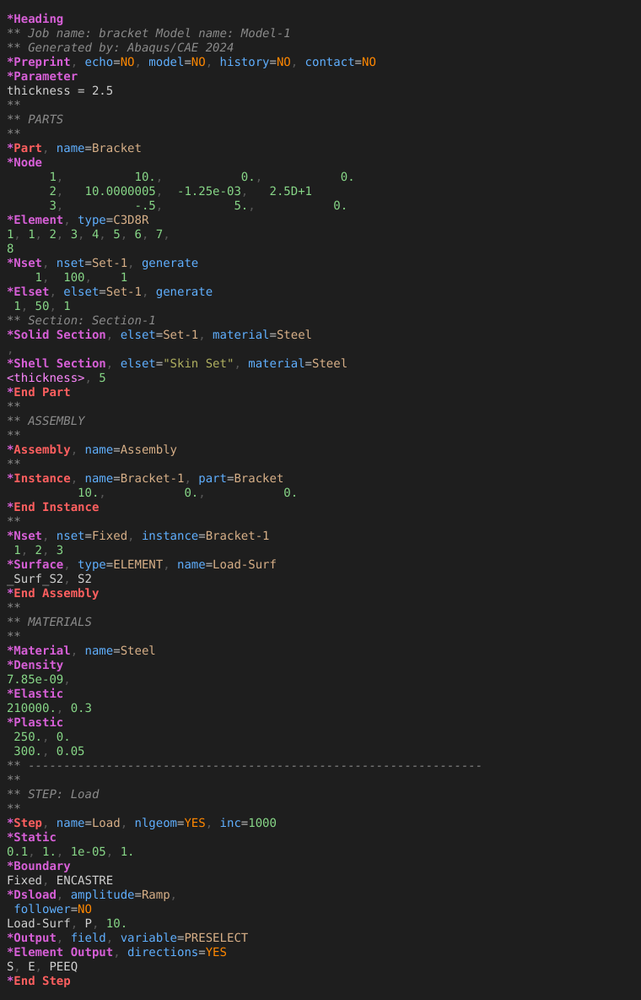

# Abaqus for Zed

Syntax highlighting and editor support for [Abaqus](https://www.3ds.com/products/simulia/abaqus) input files (`.inp`, `.inc`, `.incl`) in the [Zed](https://zed.dev) editor, built on a new Tree-sitter grammar.

Abaqus is the finite element analysis software from Dassault Systèmes SIMULIA. This extension helps you read and edit Abaqus input decks; it doesn't run Abaqus and doesn't need an Abaqus installation.

Website: [qutrit.se/zed-abaqus](https://qutrit.se/zed-abaqus/)



## Features

- **Syntax highlighting**
  - comments
  - `*Keywords`
  - parameter names and values
  - `YES`/`NO` flags
  - numbers, including Fortran-style `2.5D+1`
  - strings and `<parameter>` references
  - data lines
- **Structural keywords stand out.** `*Part`, `*Assembly`, `*Instance`, `*Step` and their `*End` lines get their own colour.
- **Outline** ("outline: toggle" for quick jump, "outline panel: toggle focus" for the panel):
  - parts, assemblies, instances and steps, nested
  - every named definition: materials, sets, surfaces, amplitudes …
- **Vim text objects and motions**:
  - `]]` / `[[` jump between parts, instances and steps; `ac` / `ic` select one
  - `]m` / `[m` jump between keyword blocks; `af` selects a whole block, `if` only its data lines
- **67 snippets.** Type `*`, then a keyword such as `node`, `material`, `static` or `contact pair`, and pick the snippet. Tab moves through the fields.
- **Comment toggling** with `Ctrl+/`, using `** `.
- **Large files.** A 28 MB / 550,000-line mesh parses in a few seconds in the background, and highlighting stays on.

## Install

The extension isn't in Zed's extension registry yet, so you install it from this repository as a dev extension. This works on Linux, macOS and Windows.

**You need:** [Zed](https://zed.dev) and [git](https://git-scm.com). Zed compiles the grammar itself; nothing else needs to be built by hand.

1. Clone the repository:
   ```bash
   git clone https://github.com/QutritLogic/zed-abaqus.git
   ```
2. In Zed, open the command palette (`Ctrl+Shift+P`, or `Cmd+Shift+P` on macOS), run **zed: install dev extension**, and choose the `zed-abaqus` folder you just cloned.
3. Wait a moment while Zed downloads and compiles the grammar. **Abaqus** then appears on the Extensions page (`zed: extensions`).

Open an `.inp` file. The language indicator in the status bar should say **Abaqus**.

**If it doesn't work:**

- Run `zed: open log` and look for errors about the Abaqus extension or grammar.
- If the log complains about Rust, install it from [rustup.rs](https://rustup.rs) and try again.
- If the file opens as plain text, check that it really ends in `.inp`, `.inc` or `.incl`; Zed picks the language by file extension. Also see *File-type conflicts* under [Known limits](#known-limits).

### Updating

Run `git pull` in the cloned folder, then press **Rebuild** on the Abaqus entry in Zed's Extensions page.

### Uninstalling

Press **Uninstall** on the Abaqus entry in Zed's Extensions page, then delete the cloned folder.

## Changing the grammar or queries

| What you change | What to do afterwards |
| --- | --- |
| Colours / captures | Edit `languages/abaqus/highlights.scm`, then **Rebuild** the extension on Zed's Extensions page. |
| Outline / text objects | Edit `outline.scm` / `textobjects.scm`, then Rebuild. |
| Snippets | Edit `make_snippets.py`, run `python3 make_snippets.py`, then Rebuild. |
| Grammar | Edit `tree-sitter-abaqus/grammar.js`, then run `tree-sitter generate` and `tree-sitter test` (needs `npm i -g tree-sitter-cli`). Run `bash install.sh` (Linux / macOS) and Rebuild. |

Zed builds the grammar from the git commit named in `extension.toml`, not from your working folder. By default that is a commit on GitHub. While you work on the grammar, `install.sh` commits `tree-sitter-abaqus/` locally and points `extension.toml` at your clone and that commit. Don't commit that `extension.toml` change; run `git checkout extension.toml` to go back to the GitHub version. When your grammar changes are pushed, set `rev` to the pushed commit.

`tree-sitter-abaqus/queries/` holds a copy of the queries for Tree-sitter's own tools (`tree-sitter highlight`, Neovim, Helix). Keep it in sync if you use those.

### Recolouring without touching the extension

The captures used are:

- `keyword`, `tag` (structural keywords), `property` (parameter names)
- `constant` (parameter values), `boolean`, `number`, `string`
- `variable` (data identifiers), `variable.special` (`<param>`)
- `comment`

Override any of them in your Zed `settings.json`:

```json
"theme_overrides": {
  "One Dark": {
    "syntax": {
      "tag":      { "color": "#e5c07b", "font_weight": 700 },
      "property": { "color": "#61afef" }
    }
  }
}
```

## Known limits

- **Folding per keyword block isn't possible.** Zed folds by indentation and Abaqus decks aren't indented. Use the outline panel to jump instead, or select a block with `af` in Vim mode and run "editor: fold selected ranges".
- **No equivalent to the VS Code "run job" helper.** Running Abaqus works the same in Zed's terminal (`abaqus job=name input=name.inp cpus=4 interactive`). You could also add it as a Zed task.
- **File-type conflicts.** If another extension also claims `.inp` or `.inc`, set it explicitly in `settings.json`:
  ```json
  "file_types": { "Abaqus": ["inp", "inc", "incl"] }
  ```
- **Comment lines are not grouped into blocks.** Comments (`**`) sit between blocks in the syntax tree. A data line that follows a comment in the middle of a block still highlights correctly.

## Repository layout

| Path | Contents |
| --- | --- |
| `extension.toml`, `languages/`, `snippets/` | The Zed extension |
| `tree-sitter-abaqus/` | The grammar: `grammar.js`, the generated parser in `src/`, tests in `test/corpus/` |
| `install.sh` | Points the extension at your local clone while you work on the grammar |
| `make_snippets.py` | Generates `snippets/abaqus.json` |

## Publishing to the Zed registry (planned)

`extension.toml` already points at this GitHub repository and a pushed commit, and the project has a license, both of which Zed's registry needs. The rest of the process is described in [Zed's publishing guide](https://zed.dev/docs/extensions/publishing/overview.html).

## License

[MIT](LICENSE).

Abaqus and SIMULIA are trademarks or registered trademarks of Dassault Systèmes or its subsidiaries. This project is independent and not affiliated with or endorsed by Dassault Systèmes.
